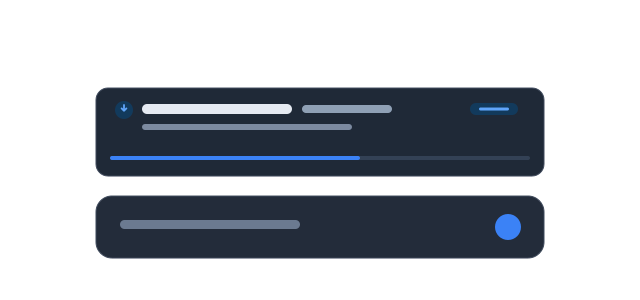

# Download and install progress (DSH plugin)

English | [中文](README.zh.md)

A progress card above the message box in the DSH Web GUI, covering two tasks:

- plugin installs and updates started by the agent with the `plugin_manager` tool;
- large file downloads started by the agent with the `download_file` tool this plugin adds.



The card follows the composer width, disappears by itself about 3 seconds after the task
settles, and can be hidden immediately with the `×` in its corner. Parallel tasks show
“N more running”.

No third-party dependencies, no build step. For DeepSeek Harness (DSH) Web.

## Install

Pick one of three ways:

1. **Let the agent install it**: ask it to run
   `plugin_manager` → `install_bundle` with
   `github:Exceptions-del/dsh-plugin-install-progress`.
2. **Plugins page**: DSH sidebar → **Plugins** → **Add plugin** → paste
   `https://github.com/Exceptions-del/dsh-plugin-install-progress`.
3. **Local directory**: clone this repository and choose the directory in **Add plugin**
   (with this form, edits take effect immediately).

Updating: reinstall when installed from GitHub (or remove and install again). For a local
directory, switch the plugin off and on in the Plugins page after editing `client.js`,
then reload the page.

## What it shows

**While installing a plugin**

- The package spec being installed (for example `@acme/foo@1.2.0`).
- The stage: preparing → downloading and installing → applying changes → done / cancelled
  / failed.
- A percentage derived from pnpm's package progress (`resolved` / `reused` /
  `downloaded`), plus “source 1/2” when more than one registry is tried.
- Packages resolved and downloaded, and elapsed time.
- The failure cause: the package manager's kind (`not-found`, `network`,
  `build-blocked`, …) or the run's own error.

**While downloading a file**

- The file name (the full path is in the hover tooltip).
- Bytes received / total size, throughput, percentage and elapsed time.
- The outcome: finished, or the HTTP status and failure reason.

## The `download_file` tool

The plugin also registers this tool so the agent can download large files with real byte
progress:

| Parameter | Required | Meaning |
| --- | --- | --- |
| `url` | yes | Absolute http(s) URL. |
| `path` | no | Destination file, relative to the session working directory or absolute inside it; defaults to the file name in the URL. |
| `overwrite` | no | Replace an existing file; defaults to `false`. |
| `expectedBytes` | no | Total size used for the percentage when the server sends no `Content-Length`. |

It follows redirects, streams the body to disk while writing, removes the partial file on
failure, keeps the destination inside the **session working directory**, and reports size,
path, duration and average throughput back to the model.

Why the tool exists: DSH's tool pipeline has no progress channel, and `curl`, `wget` and
`Invoke-WebRequest` print no progress in non-interactive captured output. A reliable
percentage therefore needs a downloader that reports bytes itself. The tool description
tells the agent to prefer `download_file` for large files.

## How it works

- **Installs**: the `plugin_manager` tool calls `installBundle` without a `requestId`, and
  the Host only streams `plugin-manager/install-state` / `install-log` for installs that
  carry one. The Host half wraps `installBundle`, adds an id only when the caller named
  none, and brackets the run with two marker log chunks (start/end). Arguments, return
  values and errors pass through untouched, so installs started from the Plugins page
  (which bring their own id) are unaffected.
- **Downloads**: `download_file` streams the response body and reports bytes received,
  throttled to one update every 150 ms.
- Both send their chunks over the one forwarded event this app exposes for streamed output
  (`plugin-manager/install-log`), each under its own marker command line. Every other
  consumer filters by `requestId`, so the Plugins dialog never sees these chunks.
- The browser half subscribes to both events, keeps the entries in one store, and renders
  the card in `conversation.input.dock` (the row above the message box).

## Data and privacy

- Nothing is stored or uploaded: progress state lives in page memory and is cleared by a
  reload or a disconnected Host.
- No session-log records, no model requests, no extra Host calls.
- `download_file` writes with the Host process's permissions, restricted by path to the
  session working directory, and asks for no per-file approval. Do not use it when a
  download is not wanted.

## Known limitations

- Only two sources are covered: installs started by the agent's `plugin_manager` tool and
  downloads started by `download_file`. `dsh plugin` in a terminal, installs started in the
  Plugins page, and shell downloads (`curl`, `wget`, `Invoke-WebRequest`) keep their own
  output and show no card.
- Install percentages count packages, not bytes: a large package advances the track only
  when pnpm reports it, and a fully cached install stays indeterminate until pnpm finishes.
- The card is read-only: it cannot cancel an install or download.
- The card lives in the conversation, so it is not visible while another main panel, such
  as **Plugins** or **Settings**, is open.
- Downloads performed inside MCP tools (for example Blender asset imports) cannot report
  progress, because they do not go through `download_file`.

## Repository layout

| File | Role |
| --- | --- |
| `index.js` | Host half: wraps `installBundle`, registers the `download_file` tool, emits marker events. |
| `client.js` | Browser half: event subscriptions, progress model, the card above the message box. |
| `package.json` | Bundle manifest: `dsh.bundle.patch` and `dsh.client`. |
| `cordis.patch.yml` | Inserts the plugin row into a profile. |
| `locale/en.json`, `locale/zh.json` | Title and description shown in the Plugins page. |
| `icon.svg`, `docs/` | Plugin icon and the detail-page illustration. |
| `test/*.test.mjs` | Tests for the Host wrapper, the download tool (against a local HTTP server) and the browser progress model. |

## Development

After an edit, apply the update step above. Run the tests (Node built-ins only; the
download test talks to the loopback interface only):

```bash
npm test        # the three test files
npm run check   # syntax check for both entry files
```

## License

[MIT](LICENSE) © 2026 Exceptions-del. Use, modify, redistribute and sell freely;
keep the copyright and license text.
