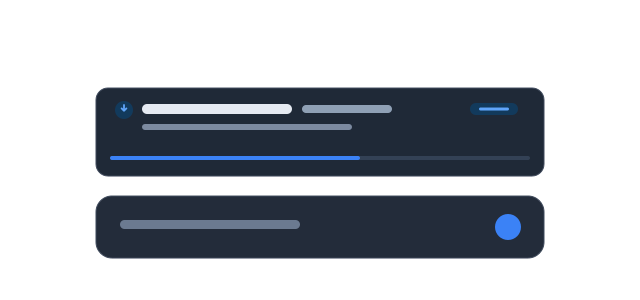

# 下载与安装进度条（DSH 插件）

[English](README.md) | 中文

在 DSH Web 界面的输入框上方显示一张进度卡片，覆盖两类任务：

- 智能体用 `plugin_manager` 工具安装 / 更新 DSH 插件时的进度；
- 智能体用本插件提供的 `download_file` 工具下载大文件时的字节进度。



卡片宽度跟随输入框，结束后约 3 秒自动消失，右上角 `×` 可立刻隐藏；多个任务并行时显示「另有 N 个进行中」。

无第三方依赖、无构建步骤，适用于 DeepSeek Harness（DSH）Web 界面。

## 安装

三种方式任选其一：

1. **让智能体装**：在会话里说「用 plugin_manager 安装 `github:Exceptions-del/dsh-plugin-install-progress`」。
2. **插件页**：DSH 侧栏 →「插件」→「添加插件」→ 粘贴
   `https://github.com/Exceptions-del/dsh-plugin-install-progress`。
3. **本地目录**：克隆本仓库到本机，「添加插件」选择该目录（这种方式改完文件即生效）。

更新：走 GitHub 安装的，重新安装一次（或先移除再安装）；本地目录方式改完 `client.js` 后，在插件页把本插件关闭再启用，然后刷新页面。

## 显示什么

**安装插件时**

- 正在安装的包名（如 `@acme/foo@1.2.0`）；
- 阶段：准备安装 → 正在下载并安装 → 正在应用更改 → 完成 / 取消 / 失败；
- 百分比：按 pnpm 的包进度换算（`resolved` / `reused` / `downloaded`），多源时显示「源 1/2」；
- 已解析/已下载包数、用时；
- 失败原因：包管理器的分类（`not-found`、`network`、`build-blocked` 等）或运行的错误。

**下载文件时**

- 文件名（完整路径在悬浮提示里）；
- 已传输 / 总大小、速率、百分比、用时；
- 结果：完成，或 HTTP 状态与失败原因。

## `download_file` 工具

插件同时注册了这个工具，供智能体下载大文件时上报真实字节进度：

| 参数 | 必填 | 说明 |
| --- | --- | --- |
| `url` | 是 | 绝对的 http(s) 地址。 |
| `path` | 否 | 目标文件，相对会话工作目录或目录内的绝对路径；省略时用 URL 里的文件名。 |
| `overwrite` | 否 | 覆盖已存在的文件，默认 `false`。 |
| `expectedBytes` | 否 | 服务器没给 `Content-Length` 时用来算百分比的总大小。 |

行为：跟随重定向、边读边写盘、失败时删除半成品；目标被限制在**会话工作目录**内；结果返回大小、路径、耗时和平均速率。

为什么需要这个工具：DSH 的工具执行管线没有进度通道，而 `curl`、`wget`、`Invoke-WebRequest` 在非交互、被捕获的输出里不会打印进度，所以「自动识别任意下载」拿不到可靠数据。要看到真实百分比，就让智能体用 `download_file`（工具描述里已写明大文件优先用它）。

## 原理

- **安装**：`plugin_manager` 工具调用 `installBundle` 时不带 `requestId`，而宿主只为带 id 的安装推送 `plugin-manager/install-state` / `install-log`。Host 半边给 `installBundle` 包一层，仅在调用方没给 id 时补一个，并用两条标记日志块（start/end）包住这次安装；参数、返回值和异常原样透传，插件页自己发起的安装（自带 id）不受影响。
- **下载**：`download_file` 流式读取响应体，按 150 ms 节流上报已接收字节。
- 两者都通过应用允许转发的流式事件（`plugin-manager/install-log`）发送，各用自己的标记命令行区分；其他消费方按 `requestId` 过滤，插件页的安装对话框不会收到这些块。
- 浏览器半边订阅这两个事件，把条目放进同一个 store，渲染到 `conversation.input.dock`（输入框上方那一排）。

## 数据与隐私

- 插件不存储、不上传任何内容：进度状态只存在于当前页面内存里，刷新或断线即清空。
- 不写会话日志，不向模型发请求，不额外请求 Host 接口。
- `download_file` 以 Host 进程权限写盘，但目标路径被限制在会话工作目录内，且不会逐文件询问授权；不需要下载时可以不使用它。

## 已知限制

- 只覆盖两类任务：智能体用 `plugin_manager` 发起的安装，以及用 `download_file` 发起的下载。`dsh plugin` 命令行、插件页手动安装、终端里的 `curl` / `wget` 各有自己的输出，不显示本卡片。
- 安装百分比按包计数、不按字节；大包要等 pnpm 报进度才前进，全缓存的安装会保持不确定进度直到 pnpm 完成。
- 卡片是只读的，不能取消安装或下载。
- 卡片在会话里，切到「插件」「设置」等其他主面板时看不到。
- 只对 `download_file` 生效的下载进度无法覆盖 MCP 工具内部的下载（例如 Blender 资源导入）。

## 仓库结构与开发

| 文件 | 作用 |
| --- | --- |
| `index.js` | Host 半边：包装 `installBundle`、注册 `download_file` 工具、上报标记事件。 |
| `client.js` | 浏览器半边：事件订阅、进度模型、输入框上方的卡片。 |
| `package.json` | bundle 清单：`dsh.bundle.patch` 与 `dsh.client`。 |
| `cordis.patch.yml` | 往 profile 插入插件行。 |
| `locale/zh.json`、`locale/en.json` | 插件页显示用的标题、说明和详情页。 |
| `icon.svg`、`docs/` | 插件图标、详情页插图。 |
| `test/*.test.mjs` | Host 包装层、下载工具（本地 HTTP 服务器）、浏览器进度模型的测试。 |

改完后按「安装」里的更新步骤生效。跑测试（只用 Node 内置模块，下载测试只连本机回环地址）：

```bash
npm test        # 三个测试文件
npm run check   # 两个入口文件的语法检查
```

## 许可证

[MIT](LICENSE) © 2026 Exceptions-del。可以自由使用、修改、再分发和商用，保留版权与许可证文本即可。
